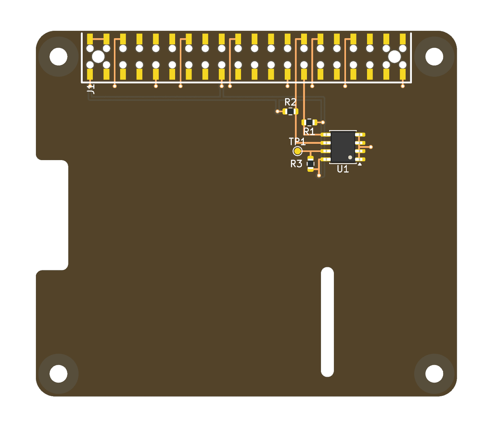

# RPi_Hat_Template

KiCad 10 project templates for a Raspberry Pi
[HAT+](https://datasheets.raspberrypi.com/hat/hat-plus-specification.pdf): the
board outline, mounting holes, 40-pin GPIO connector and the ID EEPROM a HAT+
needs, ready to design on.

| Template                      | GPIO connector                                 | Board         |
| ----------------------------- | ---------------------------------------------- | ------------- |
| [`RPi_Hat_THT`](RPi_Hat_THT/) | 2x20 through-hole female header, underneath    | 65 x 56 mm    |
| [`RPi_Hat_SMD`](RPi_Hat_SMD/) | Samtec HLE-120-02 SMD pass-through socket      | 65 x 56.5 mm  |

  
  

Each template has:

- the outline from the
  [HAT mechanical drawing](https://github.com/raspberrypi/hats/blob/master/hat-board-mechanical.pdf),
  with the display flex notch and the optional camera flex slot, and the
  drawing's dimensions on `Dwgs.User`;
- four board-only mounting holes, H1 to H4;
- the GPIO connector J1, placed and locked, with its power pins wired to
  +5V, +3V3 and GND, and a global label on each of the other 26 GPIO pins,
  named for its BCM number (`GPIO2` to `GPIO27`);
- the HAT+ ID EEPROM, placed and routed beside J1, as in the circuit in
  Raspberry Pi's HAT design guide: a CAT24C32 (U1) at address 0x50 (the
  specification's Standard class) on ID_SD and ID_SC, 3.9 kΩ pull-ups R1 and
  R2, 100 nF decoupling C1, and write protect held high by R3 (1 kΩ) at test
  point TP1, with solder jumper JP1 (open) to tie it to GND;
- a GND pour on `B.Cu`, which also carries the +3V3 routing;
- its own `RPi_Hat` symbol and footprint libraries, referenced through
  `${KIPRJMOD}`, so the project opens without installing anything.

## Using a template

1. Clone this repository, or copy one template directory out of it.
2. In KiCad choose **File → New Project from Template**, open the user
   templates tab and point it at the directory that contains the template
   directories.
3. Pick a template and name the project. KiCad copies the files and renames
   them after the project.
4. To use a GPIO pin, place its global label (`GPIO17`, say) on the part
   that connects to it, in any sheet. A label of that name anywhere joins the
   net, so keep the names for those pins.
5. Delete the camera flex slot from `Edge.Cuts` if the board does not need it.
6. Program the EEPROM with the board's HAT+ ID data before calling it a HAT+:
   pull TP1 low, or bridge JP1, to write it, with the tools in the
   specification's appendix B. Leave JP1 open afterwards so the contents stay
   locked. If the board is not to be a HAT+, delete U1, R1 to R3, C1, TP1 and
   JP1, and leave ID_SD and ID_SC unconnected; the specification allows
   nothing else on them.

## What the checks report

`just check` runs ERC and DRC (all severities, schematic parity, zones
refilled) on both templates and fails on any change from the table below; it
also fails if the two templates' `RPi_Hat` libraries differ. CI runs it in the
`kicad/kicad:10.0.6` image on every pull request and push to `main`.

| Template      | ERC | DRC | Unconnected | Parity |
| ------------- | --- | --- | ----------- | ------ |
| `RPi_Hat_THT` | 26  | 0   | 0           | 0      |
| `RPi_Hat_SMD` | 26  | 0   | 0           | 0      |

The 26 ERC findings are warnings, one `isolated_pin_label` for each GPIO pin
whose label is used nowhere else yet. Each goes away as its pin is used; the
ones left at the end are the pins the design leaves free.

The `B.Cu` pour reaches each of J1's through-hole GND pins with one thermal
spoke, as the pins sit 2.54 mm apart; `RPi_Hat_THT.kicad_dru` allows one spoke
for J1 and nothing else.

The SMD socket puts each of its 40 pads 0.127 mm from the hole its pin passes
through, under the board's 0.25 mm hole clearance. `RPi_Hat_SMD.kicad_dru`
allows that gap between the socket's own pads and holes and nowhere else.
Check that your fabricator can hold 0.127 mm copper to hole before ordering.

## Credit

Derived from [RPi_Hat_Template](https://github.com/devbisme/RPi_Hat_Template)
by Dave Vandenbout, which laid both connectors and both outlines over each
other for the user to delete one. The footprints come from his
[RPi_Hat.pretty](https://github.com/devbisme/RPi_Hat.pretty).

## License

MIT. See [LICENSE](LICENSE).
