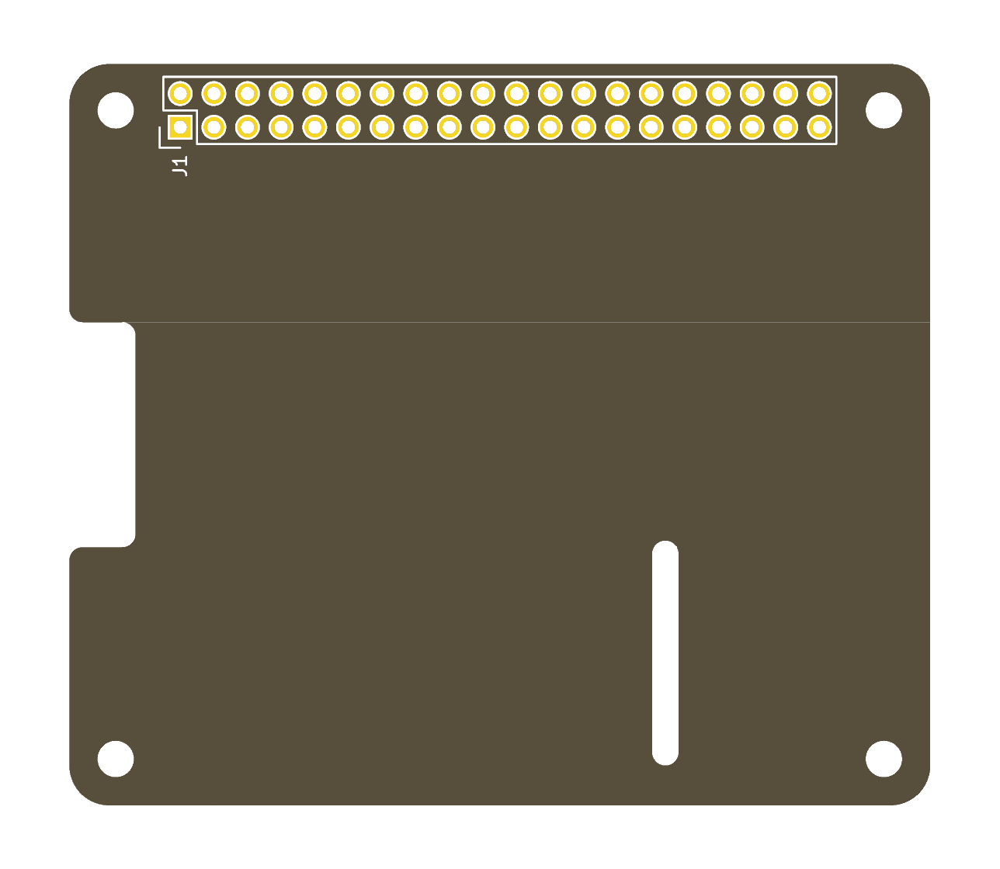
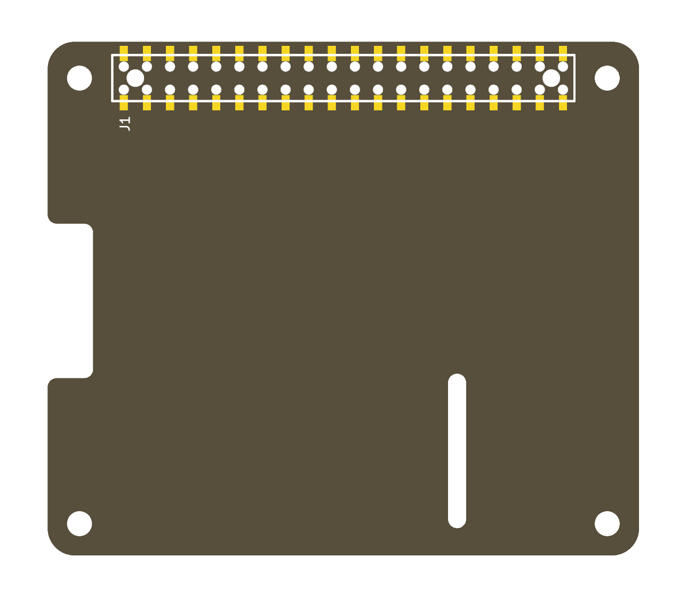

# RPi_Hat_Template

KiCad 10 project templates for a
[Raspberry Pi HAT](https://github.com/raspberrypi/hats): the board outline,
mounting holes and 40-pin GPIO connector, ready to design on.

| Template                      | GPIO connector                                 | Board         |
| ----------------------------- | ---------------------------------------------- | ------------- |
| [`RPi_Hat_THT`](RPi_Hat_THT/) | 2x20 through-hole pin header                   | 65 x 56 mm    |
| [`RPi_Hat_SMD`](RPi_Hat_SMD/) | Samtec HLE-120-02 SMD pass-through socket      | 65 x 56.5 mm  |

<p>
  
  
</p>

Each template has:

- the outline from the
  [HAT mechanical drawing](https://github.com/raspberrypi/hats/blob/master/hat-board-mechanical.pdf),
  with the display flex notch and the optional camera flex slot, and the
  drawing's dimensions on `Dwgs.User`;
- four board-only mounting holes, H1 to H4;
- the GPIO connector J1, placed and locked, with all 40 pins named in the
  schematic and left unconnected;
- its own `RPi_Hat` symbol and footprint libraries, referenced through
  `${KIPRJMOD}`, so the project opens without installing anything.

## Using a template

1. Clone this repository, or copy one template directory out of it.
2. In KiCad choose **File → New Project from Template**, open the user
   templates tab and point it at the directory that contains the template
   directories.
3. Pick a template and name the project. KiCad copies the files and renames
   them after the project.
4. In the schematic, wire the GPIO pins the design uses and put a no-connect
   flag on the others.
5. Delete the camera flex slot from `Edge.Cuts` if the board does not need it.

## What the checks report

Run with KiCad 10.0.6, all severities, schematic parity on:

```sh
kicad-cli sch erc --severity-all RPi_Hat_THT/RPi_Hat_THT.kicad_sch
kicad-cli pcb drc --severity-all --schematic-parity RPi_Hat_THT/RPi_Hat_THT.kicad_pcb
```

| Template      | ERC | DRC | Unconnected | Parity |
| ------------- | --- | --- | ----------- | ------ |
| `RPi_Hat_THT` | 52  | 0   | 0           | 0      |
| `RPi_Hat_SMD` | 52  | 80  | 0           | 0      |

The ERC count is the bare connector: 40 unconnected pins and 12 power pins
with nothing driving them. It goes away as the design is wired.

The SMD count comes from the socket footprint. Each of the 40 pads sits
0.127 mm from the hole its pin passes through, under the board's 0.25 mm hole
clearance, and the silkscreen outline crosses each pad. Decide for your
fabricator whether to relax the rule or change the footprint.

## Credit

Derived from [RPi_Hat_Template](https://github.com/devbisme/RPi_Hat_Template)
by Dave Vandenbout, which laid both connectors and both outlines over each
other for the user to delete one. The footprints come from his
[RPi_Hat.pretty](https://github.com/devbisme/RPi_Hat.pretty).

## License

MIT. See [LICENSE](LICENSE).
