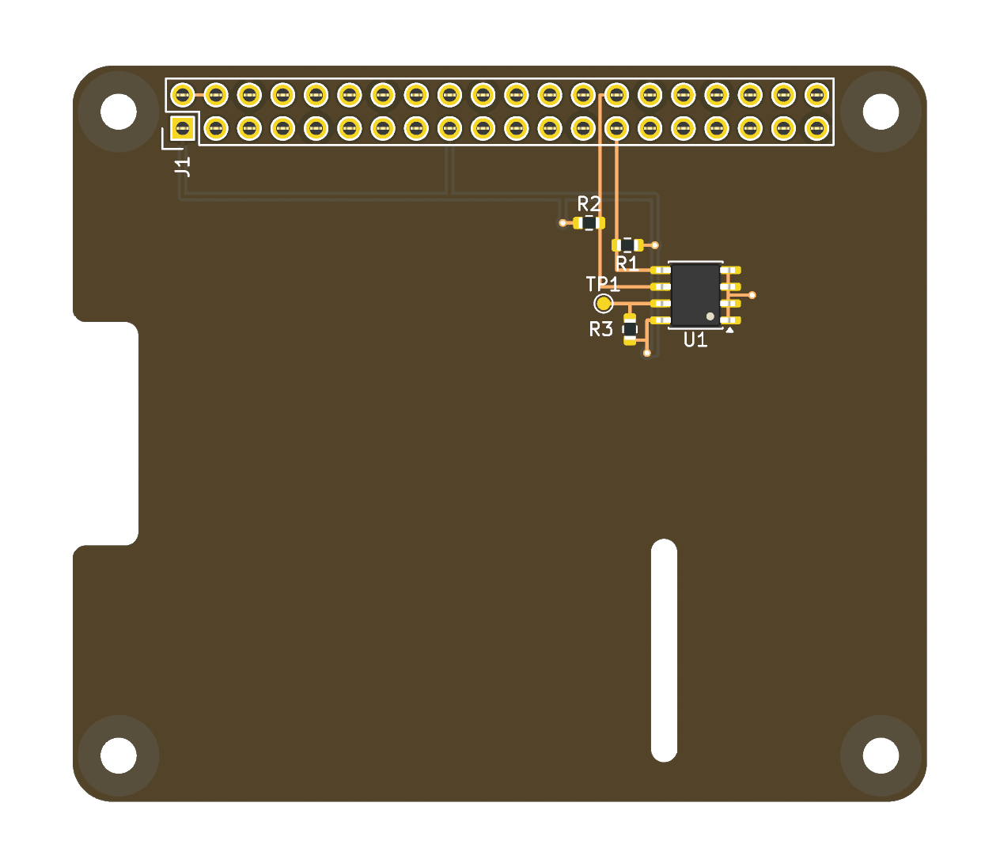

# rpi-hat-kicad

KiCad 10 project templates for a Raspberry Pi
[HAT+](https://datasheets.raspberrypi.com/hat/hat-plus-specification.pdf): the
board outline, mounting holes, 40-pin GPIO connector and the ID EEPROM a HAT+
needs, placed, routed and passing DRC, ready to design on.

**Documentation: <https://cameronbrooks11.github.io/rpi-hat-kicad/>**

| Template                      | GPIO connector                                 | Board         |
| ----------------------------- | ---------------------------------------------- | ------------- |
| [`RPi_Hat_THT`](RPi_Hat_THT/) | 2x20 through-hole female header, underneath    | 65 x 56 mm    |
| [`RPi_Hat_SMD`](RPi_Hat_SMD/) | Samtec HLE-120-02 SMD pass-through socket      | 65 x 56.5 mm  |

  
  

Each template has the outline from Raspberry Pi's HAT mechanical drawing, four
mounting holes, the GPIO connector J1 with its power pins wired and a global
label (`GPIO2` to `GPIO27`) on every other GPIO pin, and the HAT+ ID EEPROM
placed and routed beside J1. Each carries its own `RPi_Hat` libraries, so a
project opens without installing anything.

- **New HAT:** [create a project from a template](https://cameronbrooks11.github.io/rpi-hat-kicad/getting-started/).
- **Which template:** [through-hole or SMD](https://cameronbrooks11.github.io/rpi-hat-kicad/templates/); it decides how high the board sits above the Pi.
- **Calling it a HAT+:** the [HAT+ checklist](https://cameronbrooks11.github.io/rpi-hat-kicad/hat-plus/) and [programming the ID EEPROM](https://cameronbrooks11.github.io/rpi-hat-kicad/eeprom/).

## Development

With [just](https://just.systems/), Python 3 and KiCad 10's `kicad-cli`,
`just check` is the gate CI runs on every pull request: the two templates'
libraries identical, ERC finding only the 26 GPIO label warnings, and DRC
clean with schematic parity on both. The
[development page](https://cameronbrooks11.github.io/rpi-hat-kicad/development/)
covers changing a template and building the docs.

## Credit

Derived from [RPi_Hat_Template](https://github.com/devbisme/RPi_Hat_Template)
by Dave Vandenbout, which laid both connectors and both outlines over each
other for the user to delete one. The footprints come from his
[RPi_Hat.pretty](https://github.com/devbisme/RPi_Hat.pretty).

## License

MIT. See [LICENSE](LICENSE).
